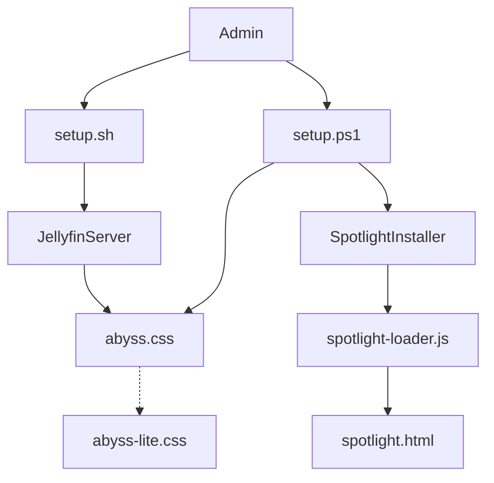

# AumGupta/abyss-jellyfin

> CSS theme for Jellyfin (frosted glass, animations) with an installer and a Spotlight banner, for media server administrators.

## The problem
Jellyfin's default theme is considered austere; it needs restyling without touching the server code.

## What it actually does
- Applies `abyss.css` (modern React/MUI and legacy interface) via Jellyfin's custom CSS.
- Windows installer (`setup.ps1` compiled to exe) and Linux installer (`setup.sh`): CSS, locked Dark theme, home section order.
- Adds a Spotlight banner showing the "Continue watching" item.
- `abyss-lite.css` option for modest clients (less blur and fewer animations).

## How it is wired


## Trying it
```bash
chmod +x abyss-setup-vX.X.X.sh
sudo ./abyss-setup-vX.X.X.sh
```
```css
@import url('https://cdn.jsdelivr.net/gh/AumGupta/abyss-jellyfin@main/abyss.css');
```

## Cost and gotchas
Free. The installer asks for the Jellyfin URL, admin username and password; the README states they stay local. Windows SmartScreen shows a warning. The CSS imported via jsDelivr depends on a CDN.

## What it is not
Not a Jellyfin plugin or a player: a theme. The admin dashboard is not styled and the Dark theme is enforced. Targets desktop browsers.

## Alternatives
None named in the README (only `abyss-je.css` and `abyss-mbe.css` stylesheets for the Jellyfin Enhanced and Media Bar plugins).

## For you
Unrelated to data / AI / MLOps: only useful if you host Jellyfin, so ignore.
