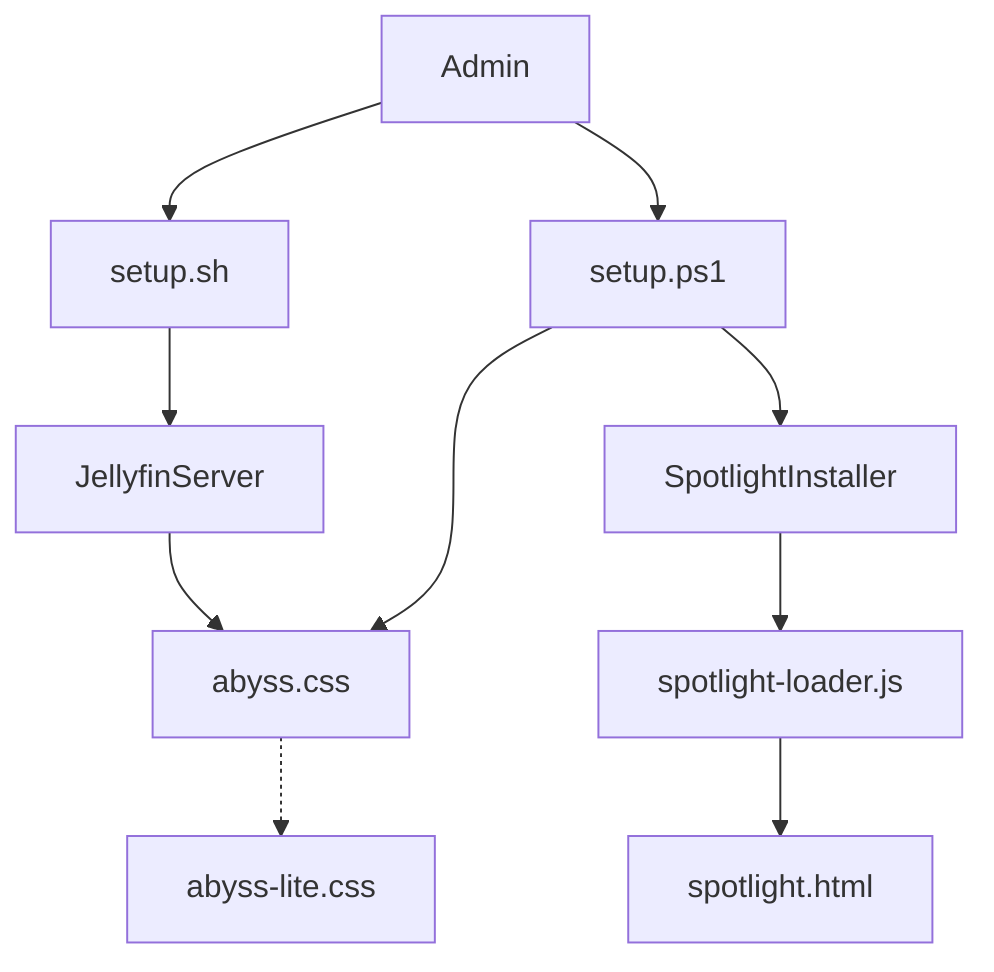

# AumGupta/abyss-jellyfin

> Thème CSS pour Jellyfin (verre dépoli, animations) avec installeur et bannière Spotlight, pour administrateurs de serveur média.

## Le problème
Le thème par défaut de Jellyfin est jugé austère ; il faut le restyler sans toucher au code du serveur.

## Ce que ça fait vraiment
- Applique `abyss.css` (interface moderne React/MUI et legacy) via le CSS personnalisé de Jellyfin.
- Installeur Windows (`setup.ps1` compilé en exe) et Linux (`setup.sh`) : CSS, thème Dark verrouillé, ordre des sections d'accueil.
- Ajoute un banner Spotlight qui montre l'élément « Continuer à regarder ».
- Option `abyss-lite.css` pour clients modestes (moins de flou et d'animations).

## Comment c'est branché


## Essayer
```bash
chmod +x abyss-setup-vX.X.X.sh
sudo ./abyss-setup-vX.X.X.sh
```
```css
@import url('https://cdn.jsdelivr.net/gh/AumGupta/abyss-jellyfin@main/abyss.css');
```

## Coût et pièges
Gratuit. L'installeur demande URL, identifiant et mot de passe admin Jellyfin ; le README affirme qu'ils restent locaux. Windows SmartScreen avertit. Le CSS importé via jsDelivr dépend d'un CDN.

## Ce que ce n'est pas
Pas un plugin Jellyfin ni un lecteur : un thème. Le tableau d'administration n'est pas stylé et le thème Dark est imposé. Ciblé navigateur de bureau.

## Alternatives
Aucune nommée dans le README (seulement des feuilles `abyss-je.css` et `abyss-mbe.css` pour plugins Jellyfin Enhanced et Media Bar).

## Pour toi
Sans lien avec data / IA / MLOps : utile seulement si tu héberges Jellyfin, donc à ignorer.

