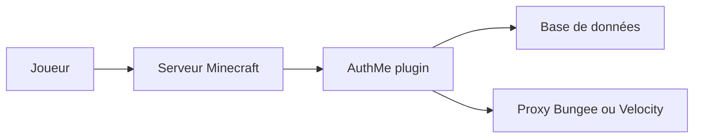

# AuthMe/AuthMeReloaded

> Password authentication plugin for Minecraft servers (Spigot, Paper, Folia, Bungee, Velocity).

## The problem
On a Minecraft server in offline mode, anyone can impersonate a username.

## What it actually does
Blocks the actions of unauthenticated players (movement, commands, inventory) until they log in. Handles sessions, two-factor authentication, recovery e-mail, anti-bot, country lists, hashed passwords (SHA256, ARGON2, BCRYPT, PBKDF2) and MySQL, MariaDB, PostgreSQL or SQLite databases. Imports accounts from other login plugins.

## How it is wired
Simplified diagram based on the note, no diagram provided.


## Trying it
```bash
mvn clean package
```

## Cost and gotchas
Free. Java 17 or 21 depending on the chosen jar (Spigot Legacy, Spigot 1.21, Paper, Folia, Bungee, Velocity). PacketEvents 2.x is required for inventory protection and for the premium bypass on direct connection.

## What it is not
Not a generic identity system: it only serves Minecraft. The premium bypass relies on Mojang; without PacketEvents, it is disabled at startup.

## Alternatives
No alternative named in the README (only the importers Auth+, LibreLogin, LimboAuth, nLogin, OpeNLogin and tiAuth appear there as migration sources).

## For you
Ignore: a Minecraft plugin, unrelated to data or MLOps.
