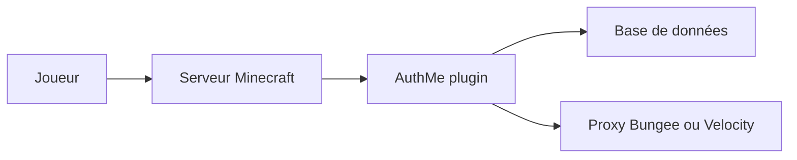

# AuthMe/AuthMeReloaded

> Plugin d'authentification par mot de passe pour serveurs Minecraft (Spigot, Paper, Folia, Bungee, Velocity).

## Le problème
Sur un serveur Minecraft en mode hors ligne, n'importe qui peut usurper un pseudo.

## Ce que ça fait vraiment
Bloque les actions des joueurs non authentifiés (déplacement, commandes, inventaire) jusqu'à leur connexion. Gère sessions, double authentification, e-mail de récupération, anti-bot, listes de pays, mots de passe hachés (SHA256, ARGON2, BCRYPT, PBKDF2) et bases MySQL, MariaDB, PostgreSQL ou SQLite. Importe les comptes d'autres plugins de connexion.

## Comment c'est branché
Schéma simplifié d'après la fiche, sans diagramme fourni.


## Essayer
```bash
mvn clean package
```

## Coût et pièges
Gratuit. Java 17 ou 21 selon le jar choisi (Spigot Legacy, Spigot 1.21, Paper, Folia, Bungee, Velocity). PacketEvents 2.x est requis pour la protection d'inventaire et le contournement premium en connexion directe.

## Ce que ce n'est pas
Pas un système d'identité générique : il ne sert qu'à Minecraft. Le contournement premium s'appuie sur Mojang ; sans PacketEvents, il est désactivé au démarrage.

## Alternatives
Aucune alternative nommée dans le README (seuls les importeurs Auth+, LibreLogin, LimboAuth, nLogin, OpeNLogin et tiAuth y figurent comme sources de migration).

## Pour toi
À ignorer : plugin Minecraft, sans lien avec la data ou le MLOps.

