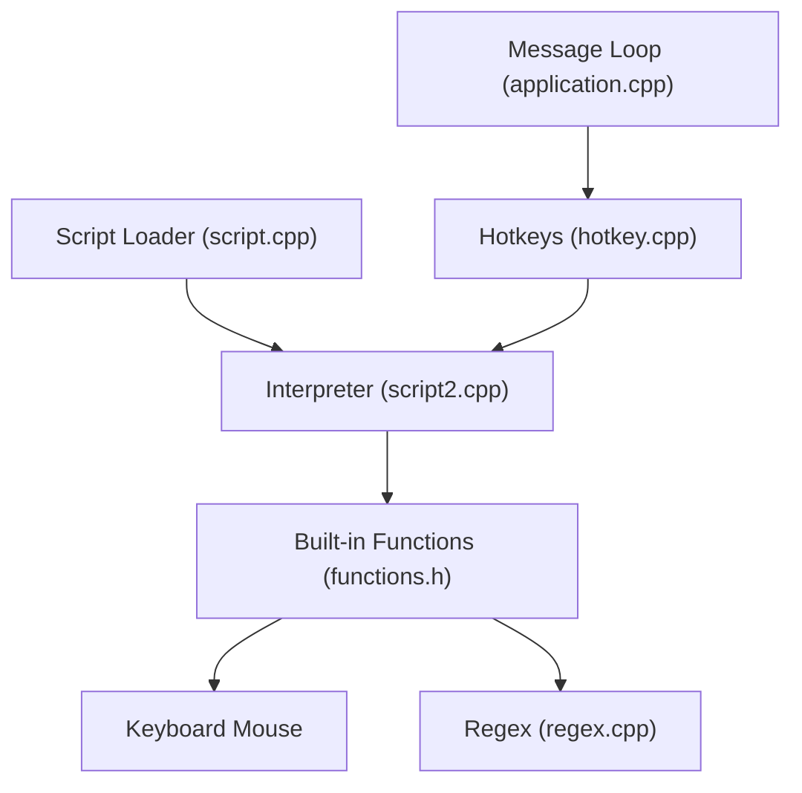

# AutoHotkey/AutoHotkey

> Windows script interpreter for automating repetitive tasks and keyboard shortcuts.

## The problem
Automating repetitive actions on Windows (keys, windows, clipboard) without writing a native application.

## What it actually does
A scripting language dedicated to shortcuts (hotkeys). The runtime loads the script, registers the handlers and dispatches keyboard, mouse and timers through a message loop. Built-in functions: windows, input sending, files, processes, clipboard, graphical interfaces, regex (PCRE), COM.

## How it is wired


## Trying it
This repository is the source code; the README describes the build:
```bash
# Ouvrir AutoHotkeyx.sln dans Visual Studio, choisir Build et Platform, puis Build
```
Ready-to-use binaries are on the official website (autohotkey.com).

## Cost and gotchas
Free. Built with Visual Studio 2026; only Windows 11 is tested with each release. GPL-2.0 license (copyleft).

## What it is not
Not cross-platform: Windows only. This repository is the engine, not a usage guide. GitHub issues were disabled from 2017 to October 2026.

## Alternatives
No alternative named in the README.

## For you
Ignore as a watch topic: a mature Windows tool but unrelated to data/AI work, useful only personally for shortcuts.
