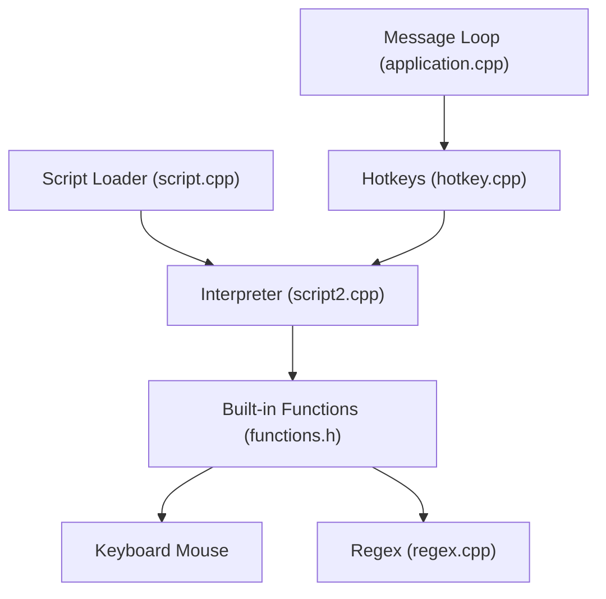

# AutoHotkey/AutoHotkey

> Interpréteur de scripts Windows pour automatiser tâches répétitives et raccourcis clavier.

## Le problème
Automatiser des actions répétitives sous Windows (touches, fenêtres, presse-papiers) sans écrire une application native.

## Ce que ça fait vraiment
Un langage de script dédié aux raccourcis (hotkeys). Le runtime charge le script, enregistre les gestionnaires et dispatche clavier, souris et minuteurs via une boucle de messages. Fonctions intégrées : fenêtres, envoi de saisie, fichiers, processus, presse-papiers, interfaces graphiques, regex (PCRE), COM.

## Comment c'est branché


## Essayer
Ce dépôt est le code source ; le README décrit la compilation :
```bash
# Ouvrir AutoHotkeyx.sln dans Visual Studio, choisir Build et Platform, puis Build
```
Les binaires prêts à l'emploi sont sur le site officiel (autohotkey.com).

## Coût et pièges
Gratuit. Compilation avec Visual Studio 2026 ; Windows 11 seul testé à chaque version. Licence GPL-2.0 (copyleft).

## Ce que ce n'est pas
Pas multiplateforme : Windows uniquement. Ce dépôt est le moteur, pas un guide d'usage. Les issues GitHub ont été désactivées de 2017 à octobre 2026.

## Alternatives
Aucune alternative nommée dans le README.

## Pour toi
À ignorer comme sujet de veille : outil Windows mature mais sans lien avec le travail data/IA, utile seulement à titre personnel pour des raccourcis.

