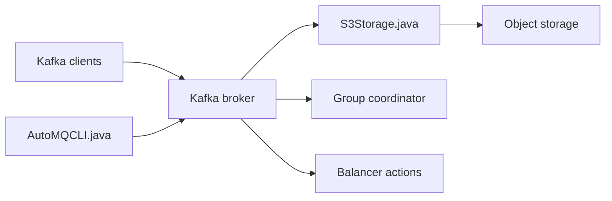

# AutoMQ/automq

> Fork of Apache Kafka that stores data on S3, to reduce the cloud costs of a streaming cluster.

## The problem
Kafka in the cloud is expensive: EBS disks, cross-zone traffic, over-provisioning, and its stateful brokers are painful to resize.

## What it actually does
Replaces Kafka's storage layer with a layer on object storage (S3 or compatible, e.g. MinIO), with a WAL and caches. Brokers become stateless. An auto-balancer spreads partitions and traffic; a rack-aware router avoids inter-AZ traffic. A "Table Topic" feature targets Apache Iceberg.

## How it is wired


## Trying it
```bash
curl -O https://raw.githubusercontent.com/AutoMQ/automq/refs/tags/1.5.5/docker/docker-compose.yaml && docker compose -f docker-compose.yaml up -d
docker compose -f docker-compose.yaml down
```

## Cost and gotchas
The quick start requires Docker 20+, Compose v2, 4 GB of RAM and ports 9092/9000 free; it is not intended for production. Latency of hundreds of milliseconds on S3 by default; single-digit milliseconds is reserved for the enterprise edition.

## What it is not
Not an identical Kafka: latency differs. The enterprise edition (control plane, Kafka Linking migration) is paid. The savings figures (90%, 10x) come from the authors.

## Alternatives
No alternative named, apart from Apache Kafka itself.

## For you
Worth watching: interesting if you pay for a cloud Kafka for data pipelines; test it on your own load before believing the README's figures.
