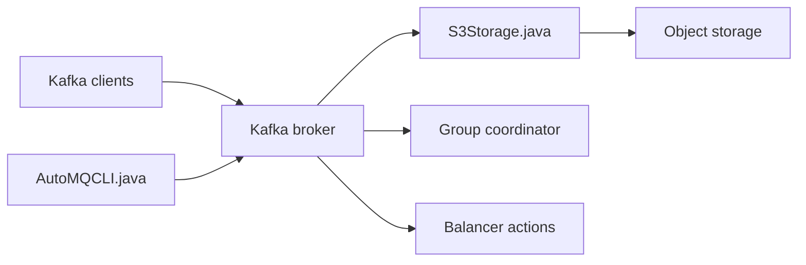

# AutoMQ/automq

> Fork d'Apache Kafka qui stocke les données sur S3, pour réduire les coûts cloud d'un cluster de streaming.

## Le problème
Kafka en cloud coûte cher : disques EBS, trafic entre zones, surdimensionnement, et ses brokers à état se redimensionnent péniblement.

## Ce que ça fait vraiment
Remplace la couche de stockage de Kafka par une couche sur stockage objet (S3 ou compatible, ex. MinIO), avec un WAL et des caches. Les brokers deviennent sans état. Un auto-balancer répartit partitions et trafic ; un routeur tient compte des racks pour éviter le trafic inter-AZ. Une fonction « Table Topic » vise Apache Iceberg.

## Comment c'est branché


## Essayer
```bash
curl -O https://raw.githubusercontent.com/AutoMQ/automq/refs/tags/1.5.5/docker/docker-compose.yaml && docker compose -f docker-compose.yaml up -d
docker compose -f docker-compose.yaml down
```

## Coût et pièges
Le démarrage rapide exige Docker 20+, Compose v2, 4 Go de RAM et les ports 9092/9000 libres ; il n'est pas destiné à la production. Latence de centaines de millisecondes sur S3 par défaut ; le millisecondes unique est réservé à l'édition entreprise.

## Ce que ce n'est pas
Ce n'est pas un Kafka identique : la latence diffère. L'édition entreprise (plan de contrôle, migration Kafka Linking) est payante. Les chiffres d'économie (90 %, 10x) viennent des auteurs.

## Alternatives
Aucune alternative nommée, hormis Apache Kafka lui-même.

## Pour toi
À surveiller : intéressant si tu paies un Kafka cloud pour des pipelines de données, à tester sur ta charge avant de croire les chiffres du README.

