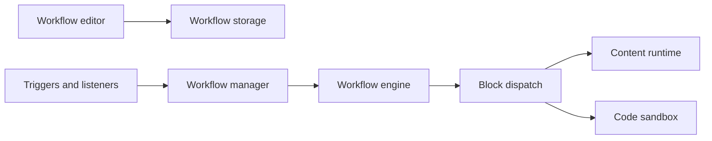

# AutomaApp/automa

> Browser extension to automate web tasks by connecting blocks, with no code.

## The problem
Filling in forms, scraping or repeating actions in the browser by hand.

## What it actually does
Block-based workflow editor in a new tab; an engine interprets the graph and delegates page actions (forms, selectors, screenshots, scraping) to content scripts. Scheduled triggers, visits, shortcuts, webhooks; Google Sheets/Drive blocks; JavaScript code in a sandbox; action recording; workflow marketplace.

## How it is wired


## Trying it
```bash
pnpm install
pnpm dev
```
First create `src/utils/getPassKey.js` (README), then load `build/` in `chrome://extensions`.

## Cost and gotchas
Free. Last push on 2026-03-02. The `getPassKey.js` file must be created to build. License present but not identified.

## What it is not
Not a large-scale scraping framework: everything runs in your browser.

## Alternatives
None named in the README.

## For you
Keep an eye on it: handy for small scrapes or one-off automations, but not a building block for a data pipeline.
