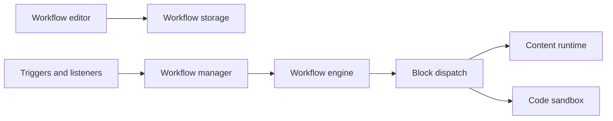

# AutomaApp/automa

> Extension de navigateur pour automatiser des tâches web en reliant des blocs, sans code.

## Le problème
Remplir des formulaires, scraper ou répéter des actions dans le navigateur à la main.

## Ce que ça fait vraiment
Éditeur de workflows par blocs dans un nouvel onglet ; un moteur interprète le graphe et délègue aux scripts de contenu les actions sur la page (formulaires, sélecteurs, captures, scraping). Déclencheurs planifiés, visites, raccourcis, webhooks ; blocs Google Sheets/Drive ; code JavaScript dans un bac à sable ; enregistrement d'actions ; marketplace de workflows.

## Comment c'est branché


## Essayer
```bash
pnpm install
pnpm dev
```
Créer d'abord `src/utils/getPassKey.js` (README), puis charger `build/` dans `chrome://extensions`.

## Coût et pièges
Gratuit. Dernier push le 2026-03-02. Fichier `getPassKey.js` à créer pour compiler. Licence présente mais non identifiée.

## Ce que ce n'est pas
Pas un framework de scraping à grande échelle : tout tourne dans ton navigateur.

## Alternatives
Aucune nommée dans le README.

## Pour toi
Surveiller : pratique pour de petits scrapings ou automatisations ponctuels, mais pas une brique de pipeline data.

