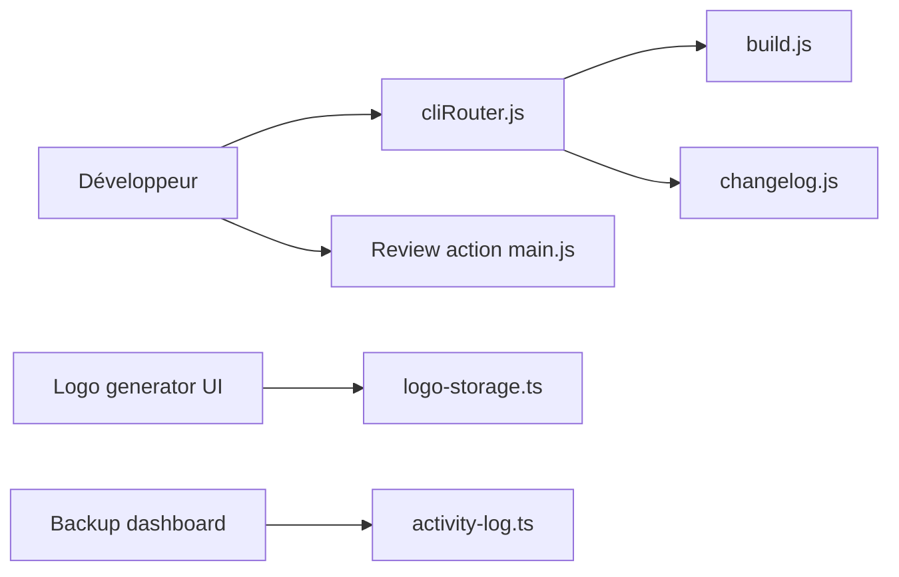

# Automattic/jetpack

> Monorepo of the Jetpack WordPress plugins, their shared packages and the development tooling.

## The problem
Maintaining several WordPress plugins and their common libraries in a single coherent repository.

## What it actually does
Contains the plugins, Composer and JavaScript packages, GitHub Actions and a monorepo CLI (build, changelog). The architecture highlights: review automation, AI logo generation, a Backup dashboard (activity log, storage plans). For simple use, the README recommends installing Jetpack from the pre-built sources.

## How it is wired


## Trying it
```bash
ln -s /path/to/jetpack-monorepo/projects/plugins/jetpack /path/to/wordpress/wp-content/plugins/jetpack
```

## Cost and gotchas
The monorepo must not be cloned into `wp-content/plugins`. The plugin must be built before use; 2,570 open issues.

## What it is not
Not a single application: a monorepo of several products; most packages are not detailed.

## Alternatives
No alternative named in the README.

## For you
Ignore: WordPress ecosystem, no value for data/AI/MLOps.
