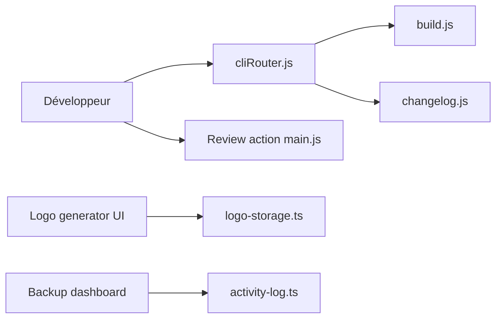

# Automattic/jetpack

> Monorepo des plugins WordPress Jetpack, de leurs paquets partagés et de l'outillage de développement.

## Le problème
Maintenir plusieurs plugins WordPress et leurs bibliothèques communes dans un seul dépôt cohérent.

## Ce que ça fait vraiment
Contient les plugins, des paquets Composer et JavaScript, des GitHub Actions et une CLI de monorepo (build, changelog). L'architecture met en évidence : automatisation de revue, génération de logos par IA, tableau de bord Backup (journal d'activité, offres de stockage). Pour un usage simple, le README recommande d'installer Jetpack depuis les sources pré-construites.

## Comment c'est branché


## Essayer
```bash
ln -s /path/to/jetpack-monorepo/projects/plugins/jetpack /path/to/wordpress/wp-content/plugins/jetpack
```

## Coût et pièges
Le monorepo ne doit pas être cloné dans `wp-content/plugins`. Il faut construire le plugin avant usage ; 2 570 issues ouvertes.

## Ce que ce n'est pas
Pas une application unique : un monorepo de plusieurs produits ; la plupart des paquets ne sont pas détaillés.

## Alternatives
Aucune alternative nommée dans le README.

## Pour toi
À ignorer : écosystème WordPress, sans valeur pour data/IA/MLOps.

