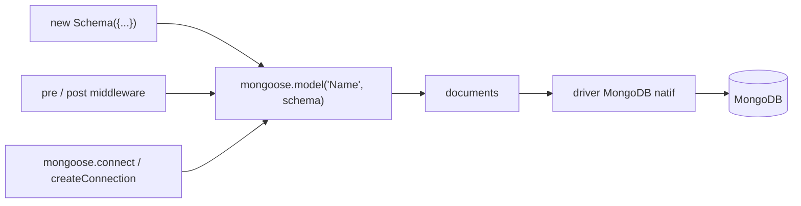

# Automattic/mongoose

> MongoDB object modeling for Node.js: schemas, validation, middleware.

## The problem
The native MongoDB driver validates nothing: every document can have any shape.
Without a schema layer, business rules get scattered throughout the application code.

## What it actually does
A `Schema` defines types, validators (synchronous and asynchronous), default values, getters/setters, indexes, methods and statics.
`pre`/`post` middlewares intercept operations and can mutate the arguments passed to the next ones.
Nested documents inherit all these features; pseudo-joins are handled by the schema.
Commands are buffered until the connection is established: you can declare models and queries before the database responds.

## How it is wired


## Trying it
```sh
npm install mongoose
pnpm add mongoose
yarn add mongoose
bun add mongoose
deno run --allow-net --allow-read --allow-sys --allow-env mongoose-test.js
```

## Cost and gotchas
Free, but you need Node.js and a MongoDB instance; Deno support is in alpha.
Mongoose 9.0.0 (November 21, 2025) introduces breaking changes documented outside the README.

## What it is not
It is not a way around the driver: going through `YourModel.collection` bypasses hooks and validation.
It is not indifferent to the connection used: a model declared on the default connection does not work on a separately created connection.
Beware of the word `type` in a schema: nested without object notation, it is interpreted as the field's type.

## Alternatives
Mongoose Studio: the team's browser GUI, to explore and edit without exporting the data.
Tidelift: commercial support and maintenance offering for dependencies, including Mongoose.

## For you
No relation to your data/AI profile: ignore unless you have a Node backend to maintain.
