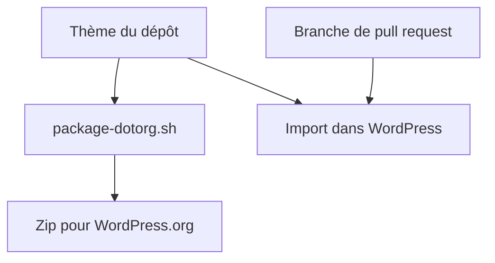

# Automattic/themes

> Retired repository of the WordPress themes maintained by the Automattic team; development has moved.

## The problem
WordPress.com and WordPress.org themes needed a shared development repository.

## What it actually does
The README announces that the repository is retired: public development has migrated to a GitHub Enterprise repository. It describes how to test a pull request, and `package-dotorg.sh [theme-slug]` produces a zip compliant with the WordPress.org review by removing the functions specific to WordPress.com. Recent themes are block themes, dependent on Gutenberg.

## How it is wired

Simplified diagram based on the sheet, no diagram provided.

## Trying it
```bash
git clone git@github.com:Automattic/themes.git
./package-dotorg.sh [theme-slug]
```

## Cost and gotchas
Free, GPL-2.0 license. Archived repository, last push in February 2025. The script rewrites the theme and discards uncommitted changes: commit first.

## What it is not
Not an up-to-date source: developments live elsewhere. Not a development tool.

## Alternatives
No alternative named in the README.

## For you
Ignore: archived and unrelated to data or AI.
