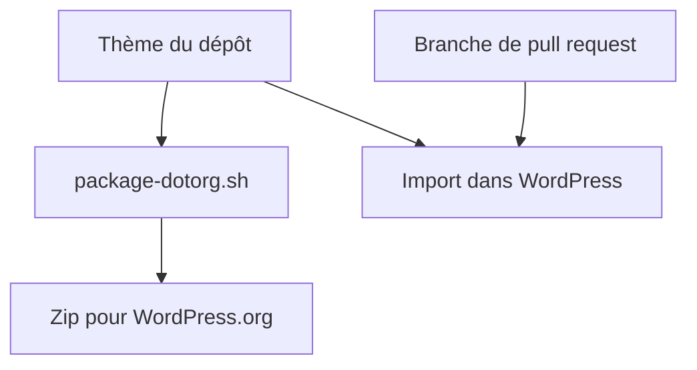

# Automattic/themes

> Dépôt, retiré, des thèmes WordPress maintenus par l'équipe Automattic ; développement déplacé.

## Le problème
Les thèmes WordPress.com et WordPress.org avaient besoin d'un dépôt de développement partagé.

## Ce que ça fait vraiment
Le README annonce que le dépôt est retiré : le développement public a migré vers un dépôt GitHub Enterprise. Il décrit comment tester une pull request, et `package-dotorg.sh [theme-slug]` produit un zip conforme à la revue WordPress.org en retirant les fonctions propres à WordPress.com. Les thèmes récents sont des thèmes en blocs, dépendants de Gutenberg.

## Comment c'est branché

Schéma simplifié d'après la fiche, sans diagramme fourni.

## Essayer
```bash
git clone git@github.com:Automattic/themes.git
./package-dotorg.sh [theme-slug]
```

## Coût et pièges
Gratuit, licence GPL-2.0. Dépôt archivé, dernier push en février 2025. Le script réécrit le thème et annule les changements non commités : valider d'abord.

## Ce que ce n'est pas
Pas une source à jour : les évolutions vivent ailleurs. Pas un outil de développement.

## Alternatives
Aucune alternative nommée dans le README.

## Pour toi
Ignorer : archivé et sans lien avec la data ou l'IA.

