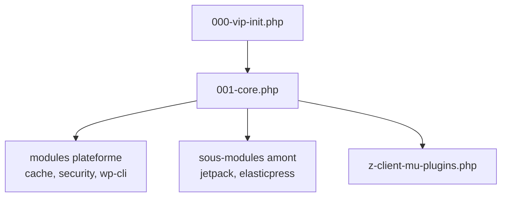

# Automattic/vip-go-mu-plugins

> Repository of the MU plugins of the WordPress VIP hosting platform, for its developers and customers.

## The problem
Running WordPress on the VIP platform requires a common base of plugins loaded at startup: cache, security, helpers, WP-CLI.

## What it actually does
An MU loading path (`000-vip-init.php`, `001-core.php`, `z-client-mu-plugins.php`) and platform modules (`cache/`, `security/`, `vip-helpers/`, `wp-cli/`). Upstream submodules (jetpack, elasticpress, wp-parsely, hyperdb...) are bundled. PHPUnit tests and Playwright e2e tests provided.

## How it is wired
Simplified diagram based on the sheet, no diagram provided.


## Trying it
```bash
git submodule update --init --recursive
composer install
npm install
npm run test:smoke
vip dev-env create --mu-plugins "$(pwd)"
vip dev-env start
```

## Cost and gotchas
No declared cost for the code; the real value assumes VIP hosting (not detailed). PHP, Composer and Node are needed for the tests.

## What it is not
Not a generic WordPress plugin to install on any site. Not a data or AI tool. It is the foundation of a specific platform.

## Alternatives
Not documented in the README.

## For you
Ignore: a WordPress VIP-specific foundation, unrelated to data, AI or MLOps work.
