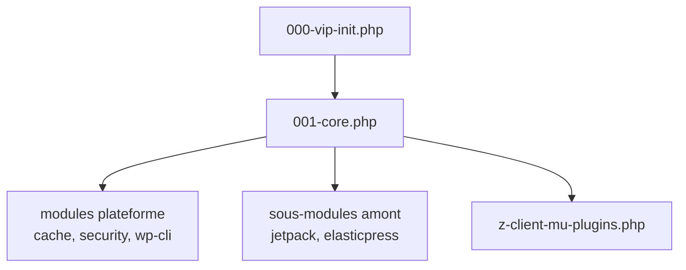

# Automattic/vip-go-mu-plugins

> Dépôt des plugins MU de la plateforme d'hébergement WordPress VIP, pour ses développeurs et clients.

## Le problème
Faire tourner WordPress sur la plateforme VIP demande un socle commun de plugins chargés au démarrage : cache, sécurité, helpers, WP-CLI.

## Ce que ça fait vraiment
Un chemin de chargement MU (`000-vip-init.php`, `001-core.php`, `z-client-mu-plugins.php`) et des modules plateforme (`cache/`, `security/`, `vip-helpers/`, `wp-cli/`). Des sous-modules amont (jetpack, elasticpress, wp-parsely, hyperdb…) sont embarqués. Tests PHPUnit et e2e Playwright fournis.

## Comment c'est branché
Schéma simplifié d'après la fiche, sans diagramme fourni.


## Essayer
```bash
git submodule update --init --recursive
composer install
npm install
npm run test:smoke
vip dev-env create --mu-plugins "$(pwd)"
vip dev-env start
```

## Coût et pièges
Pas de coût déclaré pour le code ; l'intérêt réel suppose un hébergement VIP (non détaillé). PHP, Composer et Node nécessaires pour les tests.

## Ce que ce n'est pas
Pas un plugin WordPress générique à installer sur n'importe quel site. Pas un outil data ou IA. C'est le socle d'une plateforme précise.

## Alternatives
Non documenté dans le README.

## Pour toi
À ignorer : socle spécifique à WordPress VIP, sans rapport avec un travail data, IA ou MLOps.

