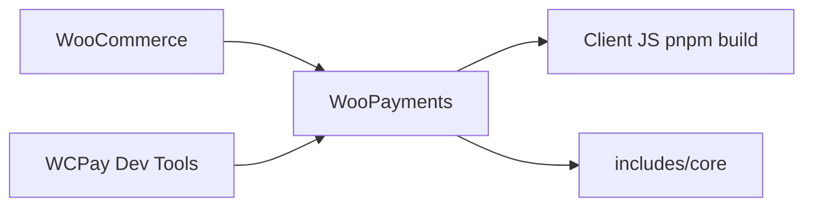

# Automattic/woocommerce-payments

> WooPayments WordPress extension, a payment gateway for WooCommerce stores.

## The problem
A WooCommerce store needs an integrated payment gateway.

## What it actually does
It is a WooCommerce extension for accepting payments. The README mainly describes the development environment (pnpm, composer, Docker, Xdebug) and the test suites (PHP, JS, E2E, QIT), not commercial usage.

## How it is wired


## Trying it
```bash
corepack enable pnpm
pnpm install
composer install
pnpm run build:client
pnpm run up:recreate
pnpm test
```

## Cost and gotchas
Composer may ask for a GitHub OAuth token. A test account and a public URL (ngrok) are required. The payment service itself is not described.

## What it is not
Not a standalone tool: requires WordPress and WooCommerce. The README says nothing about payment fees.

## Alternatives
No alternative named in the README.

## For you
Ignore: a PHP e-commerce plugin unrelated to a data / AI / MLOps profile.
