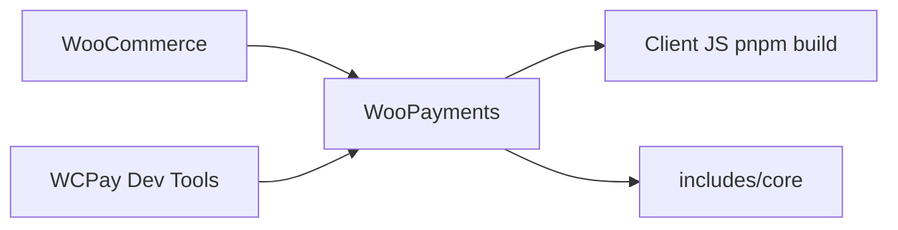

# Automattic/woocommerce-payments

> Extension WordPress WooPayments, passerelle de paiement pour boutiques WooCommerce.

## Le problème
Une boutique WooCommerce a besoin d'une passerelle de paiement intégrée.

## Ce que ça fait vraiment
C'est une extension de WooCommerce pour accepter des paiements. Le README décrit surtout l'environnement de développement (pnpm, composer, Docker, Xdebug) et les suites de tests (PHP, JS, E2E, QIT), pas l'usage commercial.

## Comment c'est branché


## Essayer
```bash
corepack enable pnpm
pnpm install
composer install
pnpm run build:client
pnpm run up:recreate
pnpm test
```

## Coût et pièges
Composer peut demander un jeton GitHub OAuth. Un compte de test et une URL publique (ngrok) sont nécessaires. Le service de paiement lui-même n'est pas décrit.

## Ce que ce n'est pas
Pas un outil autonome : exige WordPress et WooCommerce. Le README ne parle pas des frais de paiement.

## Alternatives
Aucune alternative nommée dans le README.

## Pour toi
À ignorer : plugin e-commerce PHP sans rapport avec un profil data / IA / MLOps.

