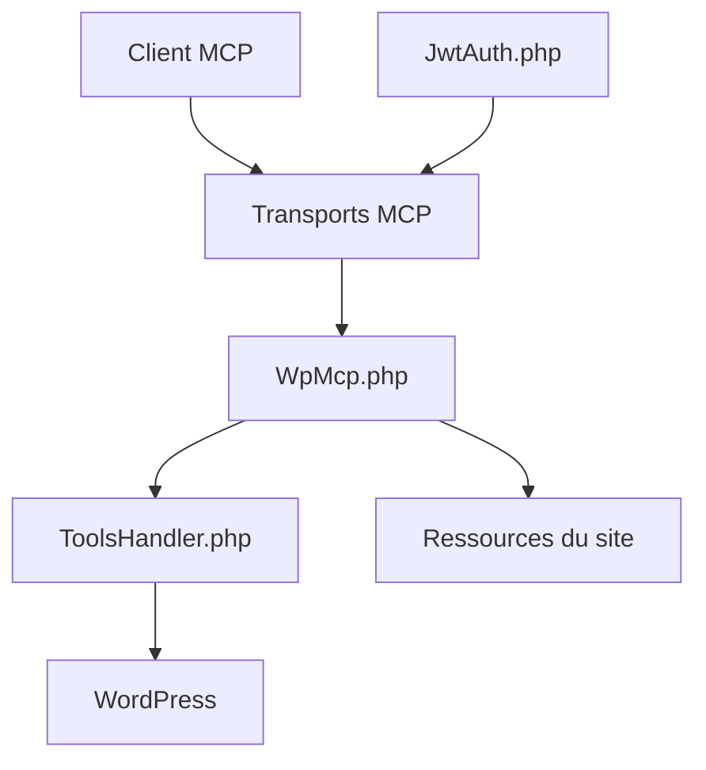

# Automattic/wordpress-mcp

> WordPress plugin that exposes the site to external AIs via MCP, with tools, resources and prompts.

## The problem
An AI assistant cannot act directly on a WordPress site without a suitable access point.

## What it actually does
- Implements an MCP access point on the server side in WordPress.
- Action tools (`create_post`, `get_user_details`), data resources and predefined prompts.
- Admin settings, JWT tokens and a CLI command to validate tools.
- Registration interfaces to add your own tools, resources and prompts.

## How it is wired


## Trying it
```bash
# Aucune commande : télécharger le .zip de la dernière version,
# l'installer via Extensions > Ajouter > Téléverser, puis activer le MCP dans Réglages > MCP Settings.
```

## Cost and gotchas
WordPress administrator account required, WordPress 6.4 and PHP 8.0 minimum (PHP is not in the list of prerequisites). Operations require administrator rights.

## What it is not
Not maintained: the repository is archived and the project is flagged as deprecated. No declared license.

## Alternatives
No alternative named in the README.

## For you
Ignore: archived and unlicensed; useful only as an example of server-side MCP architecture.
