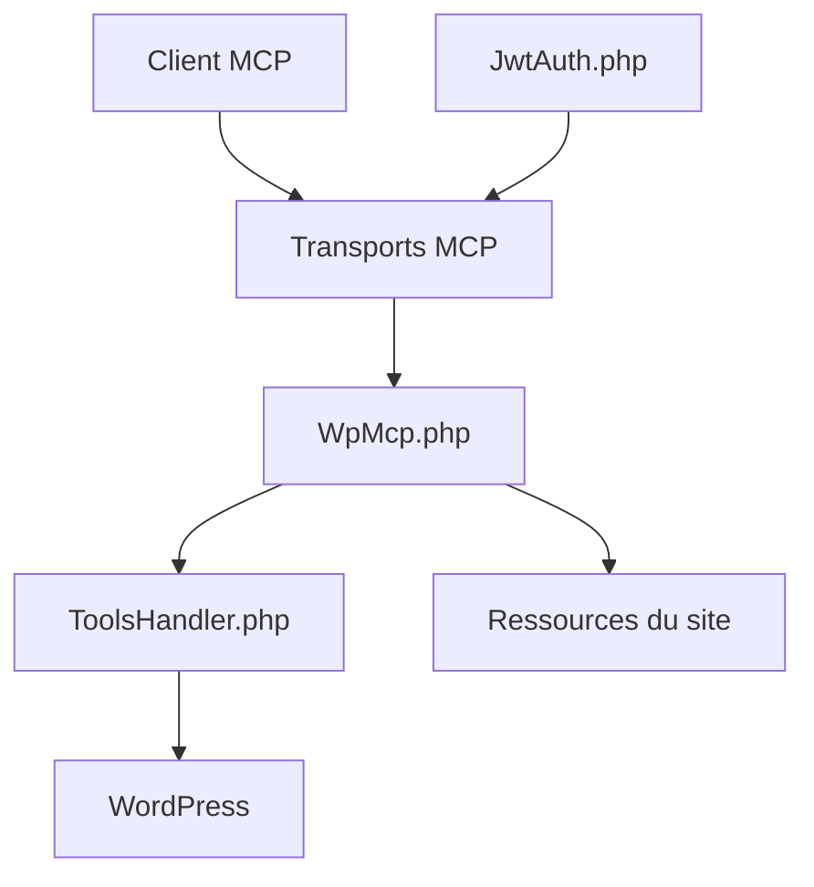

# Automattic/wordpress-mcp

> Plugin WordPress qui expose le site à des IA externes via MCP, avec outils, ressources et prompts.

## Le problème
Un assistant IA ne peut pas agir directement sur un site WordPress sans point d'accès adapté.

## Ce que ça fait vraiment
- Implémente un point d'accès MCP côté serveur dans WordPress.
- Outils d'action (`create_post`, `get_user_details`), ressources de données et prompts prédéfinis.
- Réglages d'administration, jetons JWT et commande CLI de validation des outils.
- Interfaces d'enregistrement pour ajouter ses propres outils, ressources et prompts.

## Comment c'est branché


## Essayer
```bash
# Aucune commande : télécharger le .zip de la dernière version,
# l'installer via Extensions > Ajouter > Téléverser, puis activer le MCP dans Réglages > MCP Settings.
```

## Coût et pièges
Compte WordPress administrateur requis, WordPress 6.4 et PHP 8.0 minimum (PHP n'est pas dans la liste des prérequis). Les opérations exigent les droits d'administration.

## Ce que ce n'est pas
Pas maintenu : le dépôt est archivé et le projet est signalé comme déprécié. Sans licence déclarée.

## Alternatives
Aucune alternative nommée dans le README.

## Pour toi
À ignorer : archivé et sans licence ; utile seulement comme exemple d'architecture MCP côté serveur.

