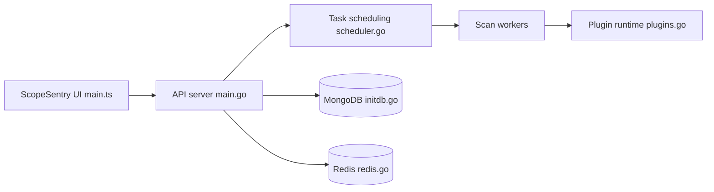

# Autumn-27/ScopeSentry

> Distributed asset-mapping and security-scanning platform for teams that monitor their exposed surface.

## The problem
Keeping track of an organization's inventory of domains, services and components, and quickly knowing which ones are hit by a new vulnerability, becomes unmanageable by hand.

## What it actually does
A server (Go API according to the code, FastAPI according to the README) distributes tasks to scan nodes. Features: subdomain enumeration, subdomain takeover detection, ports, directories, crawler, information leaks, POC scanning, page monitoring, grouping by project, webhook. A plugin system extends the tools. Results in MongoDB, queues via Redis, Vue interface.

## How it is wired


## Trying it
```bash
git clone https://github.com/Autumn-27/ScopeSentry.git
cd ScopeSentry
# Change the MongoDB and Redis account passwords in the. env file.
docker-compose -f single-host-deployment.yml up -d
docker logs scope-sentry
```

## Cost and gotchas
Free, requires Docker (4 containers: mongodb, redis, server, scan). Change the MongoDB/Redis passwords in the `.env`. No license declared: reuse rights undefined. 87 open issues.

## What it is not
Dual-use tool: to be used only on assets you own or for which you have a mandate. Not a SIEM nor a real-time defense tool. Detailed documentation is on an external site; password cracking is still "to do".

## Alternatives
No alternative named in the README (the ScopeSentry-Scan and ScopeSentry-UI repositories are its components).

## For you
Worth watching: relevant if you manage an attack surface or infrastructure security, with no clear license and no direct link with data/AI work.
