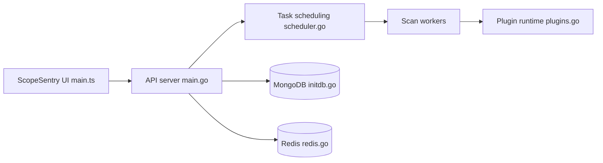

# Autumn-27/ScopeSentry

> Plateforme distribuée de cartographie d'actifs et de scan de sécurité pour équipes qui surveillent leur surface exposée.

## Le problème
Suivre l'inventaire des domaines, services et composants d'une organisation, et savoir vite lesquels sont touchés par une nouvelle vulnérabilité, devient ingérable à la main.

## Ce que ça fait vraiment
Un serveur (API en Go d'après le code, FastAPI selon le README) distribue des tâches à des nœuds de scan. Fonctions : énumération de sous-domaines, détection de prise de contrôle de sous-domaine, ports, répertoires, crawler, fuites d'informations, scan par POC, surveillance de pages, regroupement par projet, webhook. Un système de plugins étend les outils. Résultats dans MongoDB, files via Redis, interface Vue.

## Comment c'est branché


## Essayer
```bash
git clone https://github.com/Autumn-27/ScopeSentry.git
cd ScopeSentry
# Change the MongoDB and Redis account passwords in the. env file.
docker-compose -f single-host-deployment.yml up -d
docker logs scope-sentry
```

## Coût et pièges
Gratuit, nécessite Docker (4 conteneurs : mongodb, redis, serveur, scan). Changer les mots de passe MongoDB/Redis du `.env`. Aucune licence déclarée : droits de réutilisation non définis. 87 issues ouvertes.

## Ce que ce n'est pas
Outil à double usage : à n'employer que sur des actifs dont on est propriétaire ou pour lesquels on a un mandat. Ce n'est pas un SIEM ni un outil de défense en temps réel. La documentation détaillée est sur un site externe ; le crackage de mots de passe est encore « à faire ».

## Alternatives
Aucune alternative nommée dans le README (les dépôts ScopeSentry-Scan et ScopeSentry-UI sont ses composants).

## Pour toi
À surveiller : pertinent si tu gères une surface d'attaque ou de la sécurité d'infra, sans licence claire et sans lien direct avec le travail data/IA.

