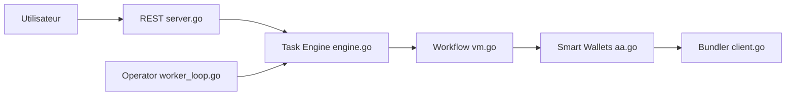

# AvaProtocol/EigenLayer-AVS

> Ethereum automation service (EigenLayer AVS): an aggregator and operators run workflows through smart wallets.

## The problem
Automatically triggering on-chain actions based on conditions (time, events) requires a trusted execution infrastructure.

## What it actually does
A Go binary (`ap-avs`) with two roles: the aggregator, run by the Ava team, receives tasks and validates the quorum; operators evaluate trigger conditions and send results back. Execution goes through one ERC6900 wallet per user and an ERC-4337 bundler (Alchemy). Multi-chain REST and gRPC API, fee estimation and storage migrations.

## How it is wired


## Trying it
```bash
go build -o ap-avs
ap-avs aggregator
make protoc-gen
golangci-lint run ./...
```

## Cost and gotchas
Go 1.22+, `ALCHEMY_API_KEY` for the bundler. The aggregator address is hard-coded in the operator and managed by the Ava team. The README lists migrations that cancel incompatible workflows.

## What it is not
Not decentralized end to end: the aggregator is centralized. The "Getting started" section is marked "Coming soon". No license declared: reuse is not guaranteed.

## Alternatives
The README cites no alternative.

## For you
Ignore: blockchain domain outside the data/AI profile, no license, and an aggregator that depends on the Ava team.
