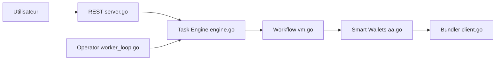

# AvaProtocol/EigenLayer-AVS

> Service d'automatisation Ethereum (AVS EigenLayer) : un agrégateur et des opérateurs exécutent des workflows via portefeuilles intelligents.

## Le problème
Déclencher automatiquement des actions on-chain selon des conditions (temps, événements) exige une infrastructure d'exécution de confiance.

## Ce que ça fait vraiment
Un binaire Go (`ap-avs`) avec deux rôles : l'agrégateur, tenu par l'équipe Ava, reçoit les tâches et valide le quorum ; les opérateurs évaluent les conditions de déclenchement et renvoient les résultats. L'exécution passe par un portefeuille ERC6900 par utilisateur et un bundler ERC-4337 (Alchemy). API REST et gRPC multi-chaînes, estimation de frais et migrations de stockage.

## Comment c'est branché


## Essayer
```bash
go build -o ap-avs
ap-avs aggregator
make protoc-gen
golangci-lint run ./...
```

## Coût et pièges
Go 1.22+, `ALCHEMY_API_KEY` pour le bundler. L'adresse de l'agrégateur est codée en dur dans l'opérateur et gérée par l'équipe Ava. Le README liste des migrations qui annulent des workflows incompatibles.

## Ce que ce n'est pas
Pas décentralisé de bout en bout : l'agrégateur est centralisé. La section « Getting started » est marquée « Coming soon ». Aucune licence déclarée : réutilisation non garantie.

## Alternatives
Le README ne cite aucune alternative.

## Pour toi
À ignorer : domaine blockchain hors profil data/IA, licence absente, et agrégateur dépendant de l'équipe Ava.

