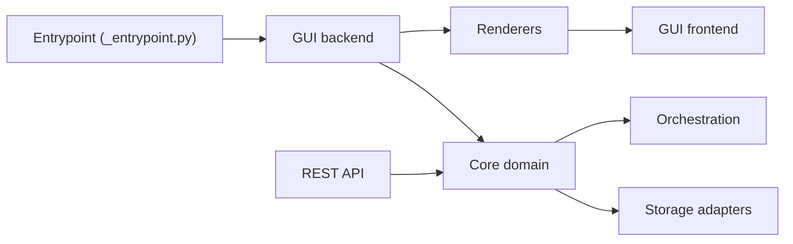

# Avaiga/taipy

> Python library for building data and AI web applications with scenario orchestration.

## The problem
Going from a notebook to a usable web application requires frontend work, pipeline orchestration and state management that data scientists do not want to write.

## What it actually does
`taipy-gui` generates an interface from Python (Markdown or builder), rendered by React components and synchronized over websocket.
`taipy-core` models scenarios, tasks, jobs and data nodes, with an orchestrator, versioning and migrations.
Data nodes to files, SQL, MongoDB, S3, Parquet; pub/sub events; separate REST API.
Project templates; Taipy Designer and Studio form the ecosystem around it.

## How it is wired


## Trying it
```bash
pip install taipy
```

## Cost and gotchas
Free library; Taipy Designer is part of an ecosystem whose license the README does not state. Telemetry is cited among the operations tools.

## What it is not
Not a simple dashboard tool: it imposes its model of scenarios and data nodes. The README is very promotional and not very technical.

## Alternatives
No alternative named in the README.

## For you
Worth watching: interesting when a demo has to handle what-if scenarios and pipelines, but heavier to learn than a classic dashboard tool.
