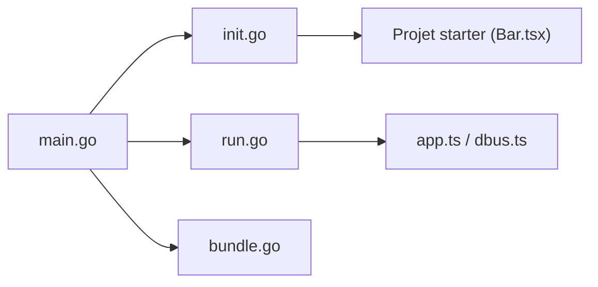

# Aylur/ags

> Bootstrapping tool for Linux desktop shell projects based on Astal and Gnim.

## The problem
Writing a desktop shell (bar, widgets) on GTK requires setting up a GJS, JSX and bundling project.

## What it actually does
The README is very short: AGS is a scaffolding CLI tool for Astal (Vala/C libraries) and Gnim (JSX for GJS). The architecture shows commands for initializing, running, bundling and inspecting instances, GTK3 and GTK4 templates, and a runtime with a D-Bus service.

## How it is wired

## Trying it
No commands documented in the README (it points to the wiki).

## Cost and gotchas
Free. Documentation lives outside the repo (wiki).

## What it is not
Not a ready-to-use shell: it generates the skeleton.

## Alternatives
None cited in the README.

## For you
Linux desktop customization, unrelated to data/AI: ignore.
