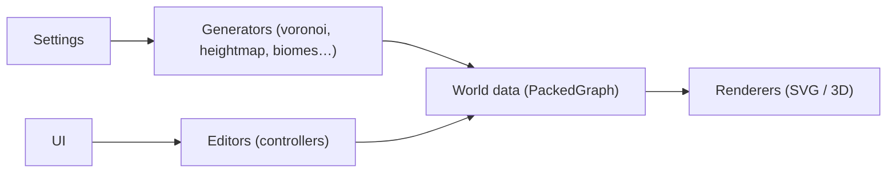

# Azgaar/Fantasy-Map-Generator

> Free web application for generating and editing fantasy maps for authors and game masters.

## The problem
Hand-drawing coherent maps (terrain, rivers, states, towns) for an imaginary world takes hours.

## What it actually does
Procedurally generates a Voronoi graph, terrain, biomes, rivers, towns, states, roads and goods. An editor lets you adjust the result; SVG rendering, optional 3D. Local save (IndexedDB), `.map` files, desktop application and Nix build. Migration from JavaScript to TypeScript is in progress.

## How it is wired


## Trying it
```bash
nix run github:Azgaar/Fantasy-Map-Generator
```
Otherwise, use the online application directly.

## Cost and gotchas
Free; support via Patreon. The author describes the code as a "draft". A license is present but not identified by GitHub.

## What it is not
Not a game engine or a real GIS tool.

## Alternatives
None named in the README.

## For you
Ignore: creative tool unrelated to your field, except for hobby use or procedural generation worth studying.
