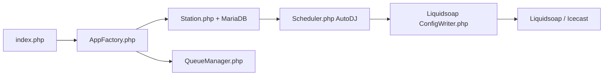

# AzuraCast/AzuraCast

> Self-hosted web radio management suite, distributed in Docker, with a web interface and API.

## The problem
Setting up a web radio means assembling a broadcast server, playlist automation and administration by hand.

## What it actually does
A PHP backend (Doctrine, MariaDB) and a Vue frontend drive stations: an AutoDJ builds the queues, a layer generates the Liquidsoap configuration, Icecast broadcasts. Message queues, Redis, Centrifugo for real time, webhooks, Flysystem storage (local, S3, SFTP…).

## How it is wired

## Trying it
No command in the README: it refers to the online installation guide (`docker-compose.sample.yml` exists in the tree).

## Cost and gotchas
Free. Docker and a Linux server; the command line is essential for installation. The project refuses AI-assisted contributions.

## What it is not
Not a hosted service: you operate the server. Not a data tool. Public demo account not intended for production.

## Alternatives
No alternative named in the README.

## For you
Ignore: mature and serious, but it is radio; its only interest is as an example of a multi-service Docker stack.
