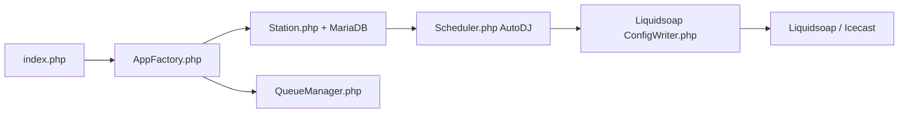

# AzuraCast/AzuraCast

> Suite auto-hébergée de gestion de webradio, distribuée en Docker, avec interface web et API.

## Le problème
Monter une webradio impose d'assembler à la main serveur de diffusion, automation des playlists et administration.

## Ce que ça fait vraiment
Backend PHP (Doctrine, MariaDB) et frontend Vue pilotent des stations : un AutoDJ construit les files d'attente, une couche génère la configuration Liquidsoap, Icecast diffuse. Files de messages, Redis, Centrifugo pour le temps réel, webhooks, stockage Flysystem (local, S3, SFTP…).

## Comment c'est branché

## Essayer
Aucune commande dans le README : renvoi au guide d'installation en ligne (`docker-compose.sample.yml` existe dans l'arbre).

## Coût et pièges
Gratuit. Docker et un serveur Linux ; ligne de commande indispensable à l'installation. Le projet refuse les contributions assistées par IA.

## Ce que ce n'est pas
Pas un service hébergé : tu opères le serveur. Pas un outil data. Compte démo public non destiné à la production.

## Alternatives
Aucune alternative nommée dans le README.

## Pour toi
Ignorer : mature et sérieux, mais c'est de la radio ; seul intérêt, un exemple d'empilement Docker multiservice.

