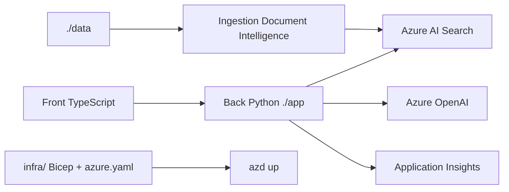

# Azure-Samples/azure-search-openai-demo

> Reference RAG application: chat over your documents with Azure OpenAI and Azure AI Search.

## The problem
Building an enterprise RAG requires assembling document ingestion, a vector index, a model,
citations, authentication and tracing — each with its own configuration pitfalls.

## What it actually does
Deploys end to end a multi-turn chat interface over your own documents: Python back end, TypeScript
front end, Bicep infrastructure, all provisioned by `azd up` on Azure Container Apps.
Shows citations and the reasoning path for each answer, and exposes settings
directly in the UI for experimenting. Options: multimodal models for image-rich documents,
voice input/output, sign-in and access control through Microsoft Entra, Application Insights
tracing. JavaScript, .NET and Java variants exist.

## How it is wired


## Trying it
```bash
azd init -t azure-search-openai-demo
azd auth login
azd env new
azd up
azd deploy
./app/start.sh
azd down
```

## Cost and gotchas
An immediate and real Azure bill: Container Apps, Container Registry, Azure OpenAI per token,
Document Intelligence per page, AI Search per hour, Blob Storage, possibly Cosmos DB,
AI Vision and Monitor. The README warns that costs keep running even if you interrupt `azd up`
midway, and insists on `azd down`. An Azure account with `roleAssignments/write` rights is required.
Python 3.10–3.14, Node 20+, PowerShell 7+ on Windows.

## What it is not
An explicit security warning: this code is a demonstration, **not to be put into
production** without hardening. It is not supported by Microsoft Support, only by the
maintainers through issues. The sample PDFs are model-generated, with no factual value.

## Alternatives
- **JavaScript, .NET, Java variants**: same features, different stack.
- **Alternative RAG chat samples**: comparison page cited in the repository's docs.

## For you
An excellent reading reference for RAG architecture; expensive and Azure-locked in practice.
