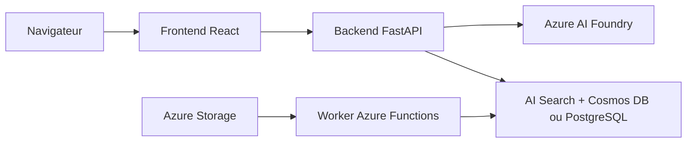

# Azure-Samples/chat-with-your-data-solution-accelerator

> Azure deployment template for a RAG chat with citations over your own documents.

## The problem
Unlock the knowledge buried in contracts, policies and manuals without searching everything by hand.

## What it actually does
Deploys with `azd up` into your Azure subscription: React front end, FastAPI API and Azure Functions ingestion worker on Container Apps. Grounded answers with citations, search via Azure AI Search + Cosmos DB or PostgreSQL + pgvector (your choice at deployment), Agent Framework or LangGraph orchestrator, Content Safety, voice, optional Entra ID. Managed identity, no Key Vault.

## How it is wired


## Trying it
```bash
azd up
azd down
```
The README points to the deployment guide for details.

## Cost and gotchas
Azure subscription with Contributor and RBAC roles; check Azure OpenAI quota beforehand; resources keep billing until you run `azd down`. Unpredictable cost depending on region and usage.

## What it is not
"A starting point, not a turnkey production system" (the README). No guarantee of retrieval quality on your data.

## Alternatives
The README cites other Microsoft accelerators: document knowledge mining, conversation knowledge mining, content processing.

## For you
Worth watching: a good skeleton if you are already on Azure, useless outside that ecosystem.
