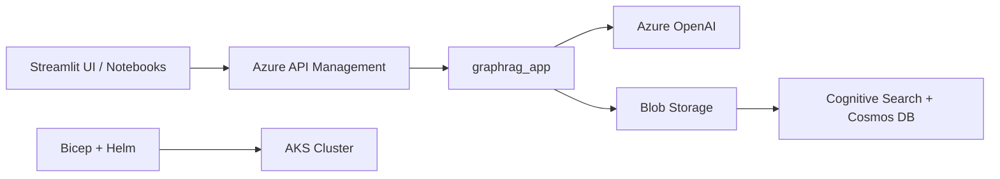

# Azure-Samples/graphrag-accelerator

> Microsoft demo that deploys the graphrag library as a hosted API on Azure, now abandoned.

## The problem
Indexing a corpus into a knowledge graph and querying it requires assembling several cloud services and an indexing pipeline yourself.

## What it actually does
Wraps the Python package `graphrag` in an API (`graphrag_app`) deployed on AKS behind Azure API Management. Kubernetes jobs index the data stored in Blob into Cosmos DB and Cognitive Search, with Azure OpenAI for the LLMs. A Streamlit frontend and two notebooks serve as demonstration. Deployment goes through Bicep modules and a Helm chart.

## How it is wired


## Trying it
The README gives no command: it points to a deployment guide and a Quickstart notebook.
```bash
# aucune commande documentée dans le README
```

## Cost and gotchas
The README warns that Azure services can cost "substantially" and that indexing is expensive: start with little data. An Azure account and a full deployment are required.

## What it is not
Not maintained (repository archived, last push 2025-05-27) and not an officially supported Microsoft offering. It is not the graphrag library itself.

## Alternatives
- graphrag (the library): the README refers to it for future developments.

## For you
Ignore: archived and tied to a costly Azure deployment; follow the graphrag library instead if GraphRAG interests you.
