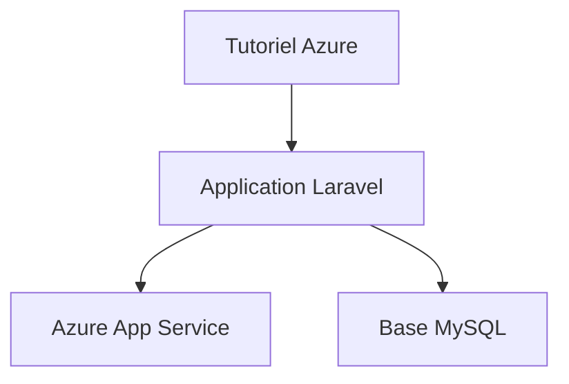

# Azure-Samples/laravel-tasks

> Laravel sample for following the Microsoft tutorial on a PHP and MySQL app on Azure App Service.

## The problem
The Azure tutorial needs a simple PHP application to deploy.

## What it actually does
The README is very short. It is Laravel's official task-list application, modified as little as possible to run on Azure App Service. It accompanies the tutorial "Build a PHP and MySQL web app in Azure".

## How it is wired
Simplified diagram based on the sheet, no diagram provided.

## Trying it
No command documented in the provided README.

## Cost and gotchas
An Azure account is required and the deployed resources are billed by Azure. The real requirement is PHP, which is not among the possible prerequisites listed.

## What it is not
It is not an application to use for its own sake: it is tutorial support material. The instructions are in the external tutorial, not in the repository.

## Alternatives
- The official Laravel repository, cited for usage instructions.

## For you
Ignore: a PHP teaching example unrelated to data or AI.
