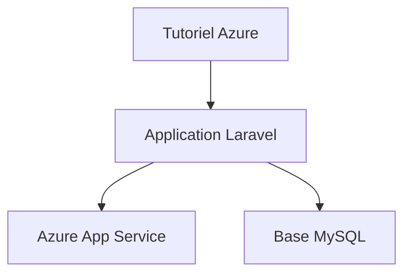

# Azure-Samples/laravel-tasks

> Exemple Laravel pour suivre le tutoriel Microsoft sur une appli PHP et MySQL sur Azure App Service.

## Le problème
Le tutoriel Azure a besoin d'une application PHP simple à déployer.

## Ce que ça fait vraiment
Le README est très court. C'est l'application officielle de liste de tâches de Laravel, modifiée le moins possible pour fonctionner sur Azure App Service. Elle accompagne le tutoriel « Build a PHP and MySQL web app in Azure ».

## Comment c'est branché
Schéma simplifié d'après la fiche, sans diagramme fourni.

## Essayer
Aucune commande documentée dans le README fourni.

## Coût et pièges
Un compte Azure est nécessaire et les ressources déployées sont facturées par Azure. Le besoin réel est PHP, non listé dans les prérequis possibles.

## Ce que ce n'est pas
Ce n'est pas une application à utiliser pour elle-même : c'est un support de tutoriel. Les instructions sont dans le tutoriel externe, pas dans le dépôt.

## Alternatives
- Le dépôt officiel de Laravel, cité pour les instructions d'usage.

## Pour toi
À ignorer : exemple pédagogique PHP sans lien avec la data ou l'IA.

