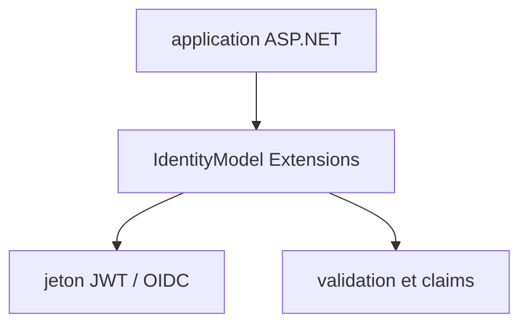

# AzureAD/azure-activedirectory-identitymodel-extensions-for-dotnet

> Microsoft .NET library for validating JWT, OpenID Connect and OAuth2 tokens in APIs.

## The problem
Validating tokens and claims correctly by hand is risky and repetitive.

## What it actually does
Provides token validation and claims handling tools, used by ASP.NET to secure applications and APIs. Version 8.x is the recommended one; 7.x is supported until November 2026, while 6.x and 5.x should be left behind. Details are provided by the wiki and the reference documentation.

## How it is wired
Simplified diagram based on the sheet, no diagram provided.

## Trying it
No command in the README: see the linked scenarios and documentation.

## Cost and gotchas
Free. Requires .NET. Older versions (5.x, 6.x) are no longer supported.

## What it is not
Not an identity server: it is an application-side library that validates tokens.

## Alternatives
No alternative named in the README.

## For you
Ignore: .NET application security, outside your data / AI / MLOps scope unless you publish APIs in C#.
