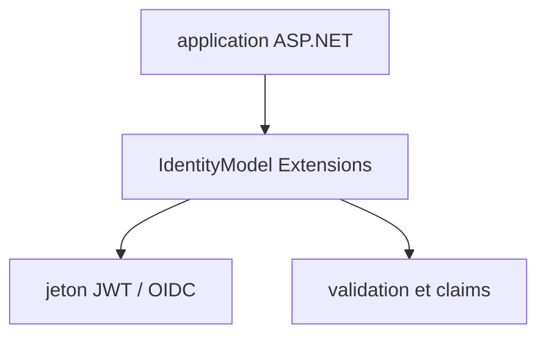

# AzureAD/azure-activedirectory-identitymodel-extensions-for-dotnet

> Bibliothèque .NET de Microsoft pour valider jetons JWT, OpenID Connect et OAuth2 dans les API.

## Le problème
Valider correctement des jetons et des revendications à la main est risqué et répétitif.

## Ce que ça fait vraiment
Fournit des outils de validation de jetons et de gestion des claims, utilisés par ASP.NET pour sécuriser applications et API. La version 8.x est la recommandée ; la 7.x est supportée jusqu'à novembre 2026, les 6.x et 5.x sont à quitter. Détails fournis par le wiki et la documentation de référence.

## Comment c'est branché
Schéma simplifié d'après la fiche, sans diagramme fourni.

## Essayer
Aucune commande dans le README : voir les scénarios et la documentation liés.

## Coût et pièges
Gratuit. Il faut .NET. Les anciennes versions (5.x, 6.x) ne sont plus supportées.

## Ce que ce n'est pas
Pas un serveur d'identité : c'est une bibliothèque côté application qui valide des jetons.

## Alternatives
Aucune alternative nommée dans le README.

## Pour toi
Ignorer : sécurité d'applications .NET, hors de ton périmètre data / IA / MLOps sauf si tu publies des API en C#.

