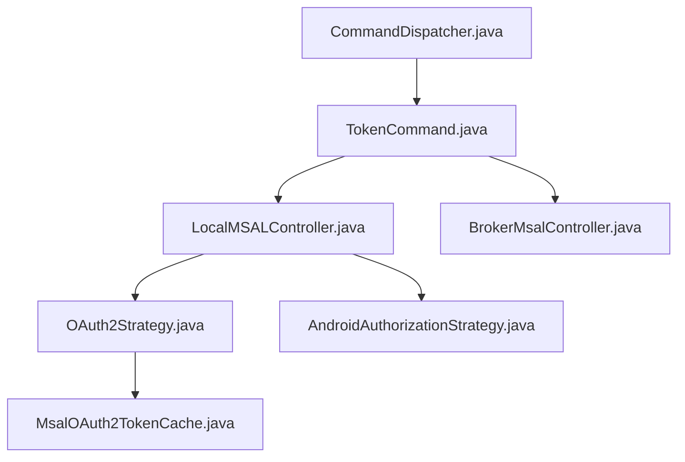

# AzureAD/microsoft-authentication-library-common-for-android

> Internal shared code of ADAL and MSAL for Android, outside the public API.

## The problem
Microsoft's Android authentication libraries share a common base of OAuth2, cache and broker.

## What it actually does
Multi-module Gradle repository: `common4j` for the protocol in Java and Kotlin (commands, OAuth2 strategies for AAD, STS, B2C, ADFS, token cache) and `common` for Android (authorization activities, browser, WebView, broker via AIDL, Keystore, native authentication). It is not a public entry point and may change without notice.

## How it is wired

## Trying it
No command documented in the README.

## Cost and gotchas
Android Studio requires the Lombok plugin to build. Issues should preferably be filed in ADAL or MSAL.

## What it is not
Not a library to use directly: the API is not public. Not a data tool either.

## Alternatives
The ADAL and MSAL libraries for Android, which use it internally.

## For you
Ignore: internal mobile authentication building block, outside your scope.
