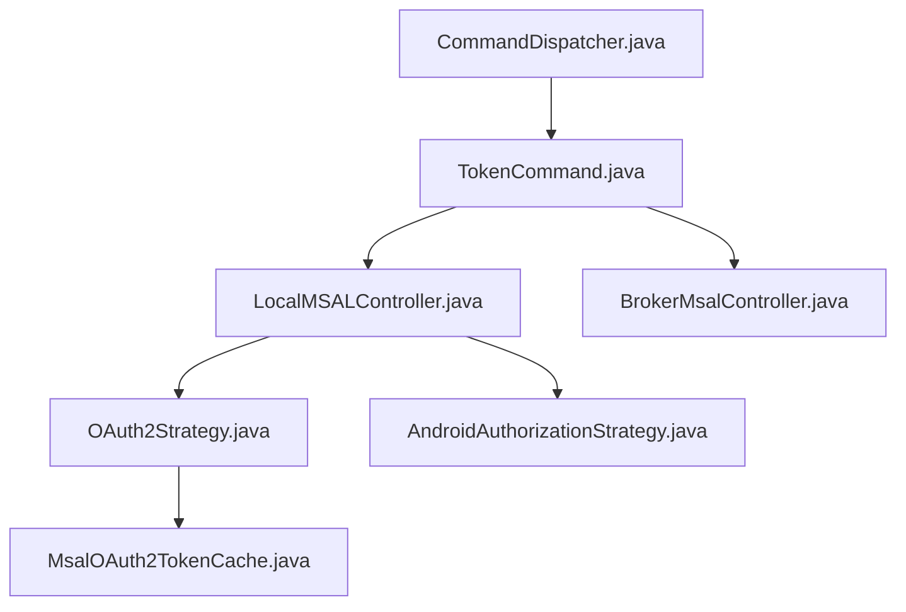

# AzureAD/microsoft-authentication-library-common-for-android

> Code partagé interne d'ADAL et MSAL pour Android, hors API publique.

## Le problème
Les bibliothèques d'authentification Android de Microsoft partagent une base commune d'OAuth2, de cache et de courtier.

## Ce que ça fait vraiment
Dépôt Gradle multi-modules : `common4j` pour le protocole en Java et Kotlin (commandes, stratégies OAuth2 pour AAD, STS, B2C, ADFS, cache de jetons) et `common` pour l'Android (activités d'autorisation, navigateur, WebView, courtier via AIDL, Keystore, authentification native). Il n'est pas un point d'entrée public et peut changer sans préavis.

## Comment c'est branché

## Essayer
Aucune commande documentée dans le README.

## Coût et pièges
Android Studio demande le plugin Lombok pour compiler. Les problèmes se déclarent de préférence dans ADAL ou MSAL.

## Ce que ce n'est pas
Pas une bibliothèque à utiliser directement : l'API n'est pas publique. Pas non plus un outil de data.

## Alternatives
Les bibliothèques ADAL et MSAL pour Android, qui l'utilisent en interne.

## Pour toi
À ignorer : brique interne d'authentification mobile, hors de ton périmètre.

