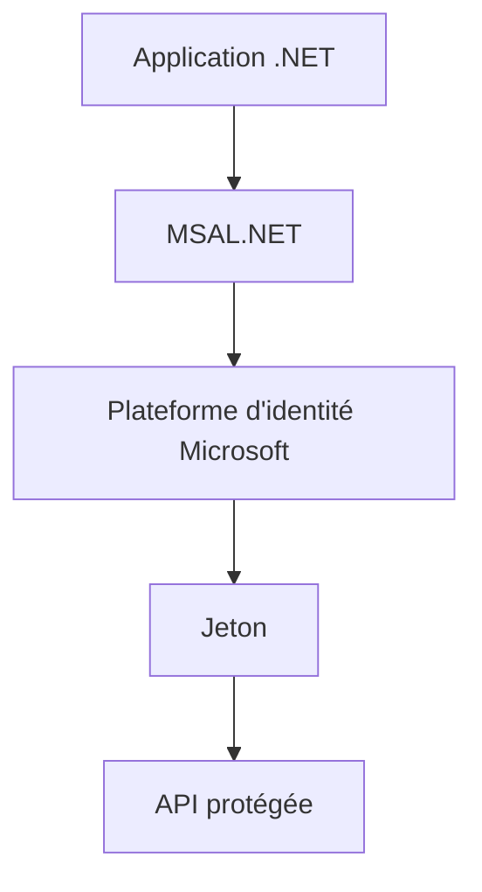

# AzureAD/microsoft-authentication-library-for-dotnet

> .NET library for obtaining Microsoft Entra tokens and calling protected APIs.

## The problem
Implementing OAuth2 and OpenID Connect by hand to sign in to the Microsoft identity platform is slow and risky.

## What it actually does
MSAL.NET acquires security tokens via OAuth2 and OpenID Connect, including for Azure AD B2C. The README mostly describes reduced logging (the MSAL_REDUCED_LOGGING variable), data collection and security, and points to Microsoft Learn for usage.

## How it is wired
Simplified diagram based on the fiche, no diagram provided.

## Trying it
No command documented in the README: it points to the Microsoft Learn documentation and a NuGet package.

## Cost and gotchas
Free library, but you need a tenant or an application registration on the Microsoft side. The software may send telemetry data to Microsoft, which can be disabled.

## What it is not
Not an identity server: it is a client. Reserved for the .NET ecosystem.

## Alternatives
No alternative named in the README.

## For you
Ignore unless you develop in .NET on Azure: in data/AI you will go through the Python SDKs.
