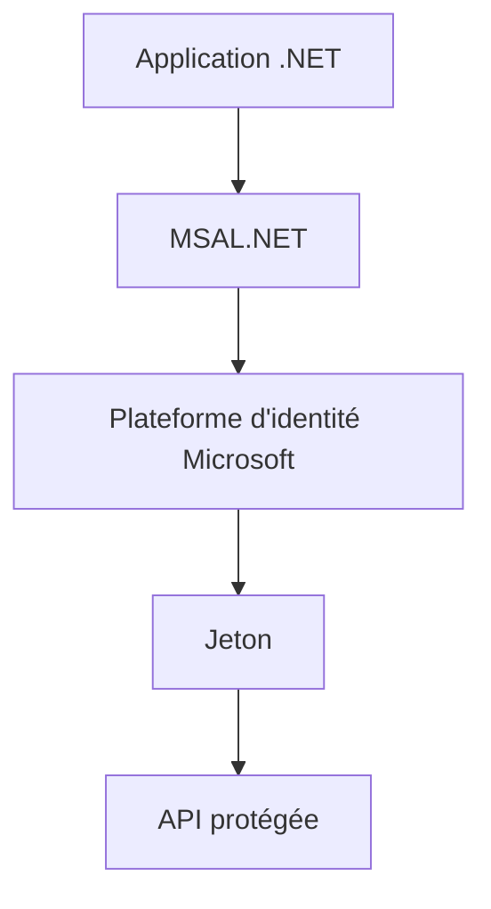

# AzureAD/microsoft-authentication-library-for-dotnet

> Bibliothèque .NET pour obtenir des jetons Microsoft Entra et appeler des API protégées.

## Le problème
Implémenter à la main OAuth2 et OpenID Connect pour se connecter à la plateforme d'identité Microsoft est long et risqué.

## Ce que ça fait vraiment
MSAL.NET acquiert des jetons de sécurité via OAuth2 et OpenID Connect, y compris pour Azure AD B2C. Le README décrit surtout la journalisation réduite (variable MSAL_REDUCED_LOGGING), la collecte de données, la sécurité et renvoie à Microsoft Learn pour l'usage.

## Comment c'est branché
Schéma simplifié d'après la fiche, sans diagramme fourni.

## Essayer
Aucune commande documentée dans le README : il renvoie vers la documentation Microsoft Learn et un package NuGet.

## Coût et pièges
Bibliothèque gratuite, mais il faut un tenant ou une inscription d'application côté Microsoft. Le logiciel peut envoyer des données de télémétrie à Microsoft, désactivables.

## Ce que ce n'est pas
Pas un serveur d'identité : c'est un client. Réservé à l'écosystème .NET.

## Alternatives
Aucune alternative nommée dans le README.

## Pour toi
Ignorer sauf si tu développes en .NET sur Azure : en data/IA tu passeras par les SDK Python.

