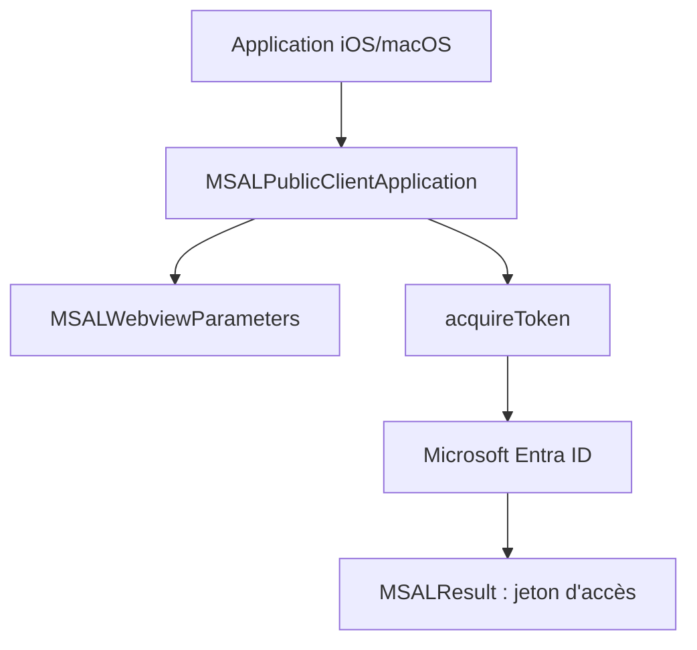

# AzureAD/microsoft-authentication-library-for-objc

> Microsoft SDK for authenticating users with Entra ID in iOS and macOS applications.

## The problem
Integrating OAuth2 and OpenID Connect with Microsoft identities in an Apple application is complex.

## What it actually does
MSAL obtains tokens from the Microsoft identity platform, with single sign-on, conditional access and authentication delegated to a broker. It offers browser-based authentication and native authentication. Version 2.x brings breaking changes.

## How it is wired
Simplified diagram based on the sheet, no diagram provided.


## Trying it
```bash
git submodule add https://github.com/AzureAD/microsoft-authentication-library-for-objc msal
```
Also installable via CocoaPods (`pod 'MSAL'`), Carthage or Swift Package Manager.

## Cost and gotchas
Free on the SDK side, but the application must be registered in the Microsoft Entra admin center. The `master` branch is no longer updated: use `main`.

## What it is not
Not a cross-platform SDK: iOS and macOS only. It does not replace ADAL, deprecated in 2023, with no migration path.

## Alternatives
No alternative named in the README.

## For you
Ignore: Apple application development, unrelated to data or AI pipelines.
