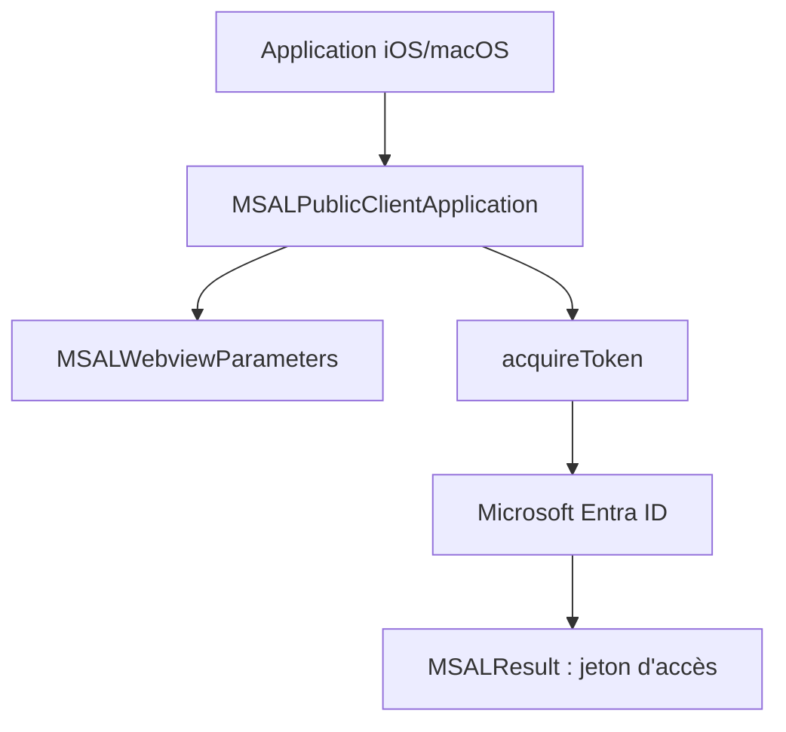

# AzureAD/microsoft-authentication-library-for-objc

> SDK Microsoft pour authentifier des utilisateurs avec Entra ID dans des applications iOS et macOS.

## Le problème
Intégrer OAuth2 et OpenID Connect avec les identités Microsoft dans une application Apple est complexe.

## Ce que ça fait vraiment
MSAL obtient des jetons auprès de la plateforme d'identité Microsoft, avec connexion unique, accès conditionnel et authentification déléguée à un courtier. Il propose l'authentification via navigateur et une authentification native. La version 2.x apporte des ruptures de compatibilité.

## Comment c'est branché
Schéma simplifié d'après la fiche, sans diagramme fourni.


## Essayer
```bash
git submodule add https://github.com/AzureAD/microsoft-authentication-library-for-objc msal
```
Installation aussi par CocoaPods (`pod 'MSAL'`), Carthage ou Swift Package Manager.

## Coût et pièges
Gratuit côté SDK, mais il faut enregistrer l'application dans le centre d'administration Microsoft Entra. Le branche `master` n'est plus mise à jour : utiliser `main`.

## Ce que ce n'est pas
Ce n'est pas un SDK multiplateforme : iOS et macOS seulement. Il ne remplace pas ADAL, abandonné en 2023, sans migration.

## Alternatives
Aucune alternative nommée dans le README.

## Pour toi
À ignorer : développement d'applications Apple, sans lien avec la data ou les pipelines IA.

