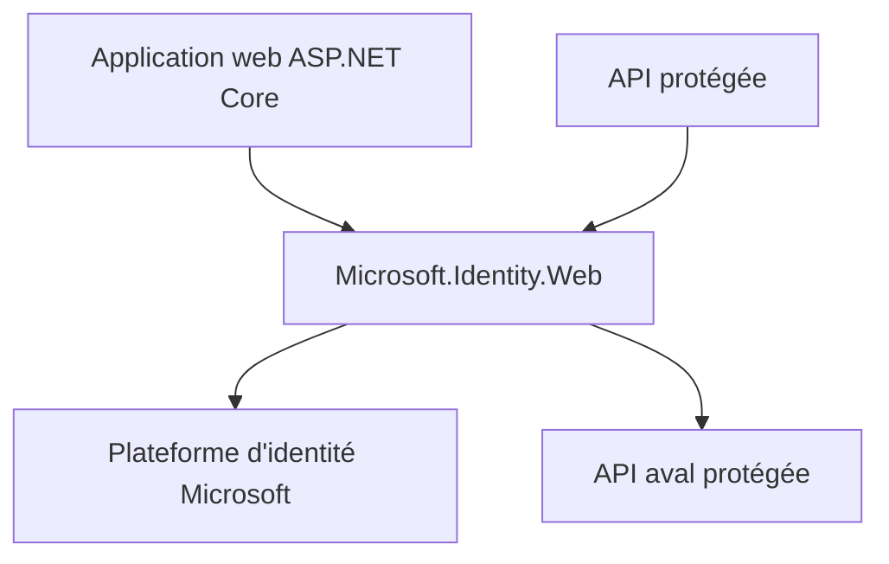

# AzureAD/microsoft-identity-web

> ASP.NET Core library for authentication via Microsoft Entra ID and Azure AD B2C.

## The problem
Wiring user sign-in and API protection to the Microsoft identity platform is repetitive and delicate.

## What it actually does
Reusable classes for web applications that sign in users and call APIs, and for protected APIs that call other APIs. Guides cover authority configuration for Azure AD, B2C and CIAM. The README points to the wiki and the samples.

## How it is wired
Simplified diagram based on the sheet, no diagram provided.


## Trying it
```bash
dotnet build Microsoft.Identity.Web.sln -p:TargetNetNext=True
dotnet test Microsoft.Identity.Web.sln -f net10.0 -p:TargetNetNext=True
```
These commands are for building with the .NET 10 previews.

## Cost and gotchas
Free, but a Microsoft tenant (account to create) is required. The preview .NET 10 SDK is required for the described build. 344 open issues.

## What it is not
Not an identity provider: it only plugs into Microsoft's. Not for stacks other than .NET.

## Alternatives
No alternative cited in the README.

## For you
Ignore: only useful if you protect a .NET API with Entra ID; otherwise out of scope.
