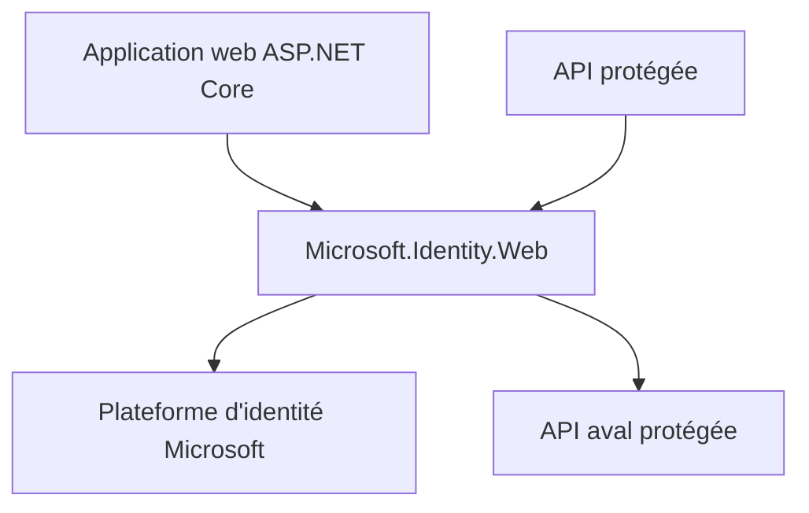

# AzureAD/microsoft-identity-web

> Bibliothèque ASP.NET Core pour l'authentification via Microsoft Entra ID et Azure AD B2C.

## Le problème
Brancher la connexion des utilisateurs et la protection d'API sur la plateforme d'identité Microsoft est répétitif et délicat.

## Ce que ça fait vraiment
Des classes réutilisables pour des applications web qui connectent des utilisateurs et appellent des API, et pour des API protégées qui en appellent d'autres. Des guides couvrent la configuration d'autorité pour Azure AD, B2C et CIAM. Le README renvoie au wiki et aux exemples.

## Comment c'est branché
Schéma simplifié d'après la fiche, sans diagramme fourni.


## Essayer
```bash
dotnet build Microsoft.Identity.Web.sln -p:TargetNetNext=True
dotnet test Microsoft.Identity.Web.sln -f net10.0 -p:TargetNetNext=True
```
Ces commandes servent à compiler avec les préversions .NET 10.

## Coût et pièges
Gratuit, mais un locataire Microsoft (compte à créer) est nécessaire. Le SDK .NET 10 en préversion est requis pour le build décrit. 344 issues ouvertes.

## Ce que ce n'est pas
Pas un fournisseur d'identité : il ne fait que se brancher à celui de Microsoft. Pas pour d'autres piles que .NET.

## Alternatives
Aucune alternative citée dans le README.

## Pour toi
Ignorer : utile seulement si tu protèges une API .NET avec Entra ID ; sinon hors périmètre.

