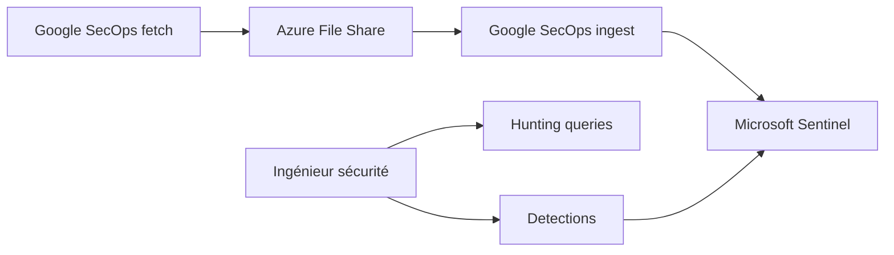

# Azure/Azure-Sentinel

> Official security content repository for Microsoft Sentinel and Microsoft 365 Defender.

## The problem
A SOC team adopting Sentinel has to write its own detections, hunting queries, workbooks and playbooks before becoming operational.

## What it actually does
A collection of detections, exploration and hunting queries (KQL), workbooks and playbooks, plus ingestion connectors (Google SecOps, Infoblox, Netskope) that go through an Azure File Share before Sentinel. Contributions are validated by YAML structure and KQL syntax tests in CI, which can be replayed locally with `dotnet test`.

## How it is wired


## Trying it
```bash
cd Azure-Sentinel\\.script\tests\KqlvalidationsTests\
dotnet test
```

## Cost and gotchas
The content is MIT, but it only has value within a Microsoft Sentinel subscription (billed, not priced in the README). Local validation requires the .NET Core 3.1 SDK.

## What it is not
Not an application or a single product: a community content repository with no integrated runtime. The README mostly describes the contribution process.

## Alternatives
No alternative named in the README.

## For you
Ignore: unless you do threat detection on Sentinel, this KQL catalog has no use in data/AI/MLOps.
