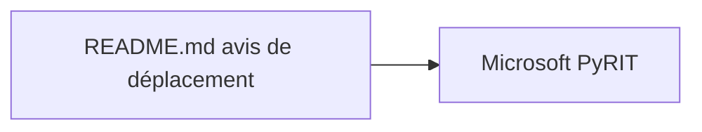

# Azure/PyRIT

> Archived repository of a generative AI risk assessment framework, now moved to Microsoft.

## The problem
Systematically spotting the risks of a generative AI system before it goes live.

## What it actually does
This repository now only contains the moving notice: the README points to https://github.com/microsoft/PyRIT. No runtime code is present, so its behavior cannot be verified here. Very short README: minimal sheet.

## How it is wired

## Trying it
No command documented. The README only offers the link to the new repository.

## Cost and gotchas
Nothing to install here. Archived repository (last push on 2026-03-25): no fix or update will come from this location.

## What it is not
It is not the active project: it is a redirect shell. Nor is it a source for evaluating the tool, for lack of code.

## Alternatives
microsoft/PyRIT, cited in the README as the project's new address.

## For you
Ignore: archived repository with no code; if generative AI risk assessment interests you, go straight to microsoft/PyRIT.
