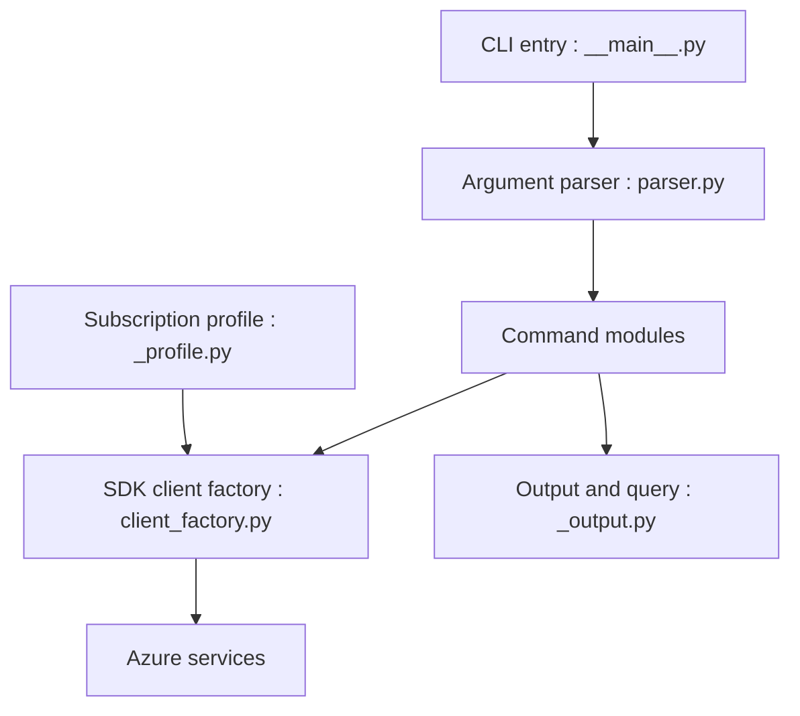

# Azure/azure-cli

> Microsoft's official command line for managing Azure resources, cross-platform.

## The problem
Driving Azure through scripts rather than the portal.

## What it actually does
Command `az group subgroup command`. The core parses arguments, calls the Azure APIs through command modules, and handles authentication, output and extensions. Tab completion, JMESPath queries, `az rest`, documented exit codes.

## How it is wired


## Trying it
```bash
az storage -h
az vm create -h
az vm list --query "[?provisioningState=='Succeeded'].{ name: name, os: storageProfile.osDisk.osType }"
az config set core.collect_telemetry=no
```

## Cost and gotchas
The tool is free, Azure resources are not. Telemetry is on by default; disable it with `az config set core.collect_telemetry=no`. 3,984 open issues.

## What it is not
Useless outside Azure. The README's "edge" builds are development versions.

## Alternatives
No alternative named in the README.

## For you
Worth watching: essential if your ML workloads run on Azure, of no interest otherwise; remember to turn off telemetry.
