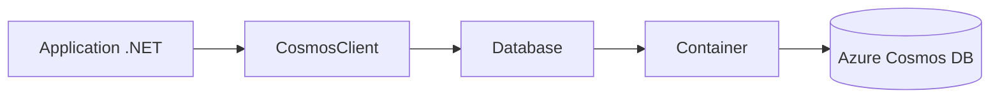

# Azure/azure-cosmos-dotnet-v3

> Official .NET SDK for connecting to Azure Cosmos DB for NoSQL.

## The problem
Query Cosmos DB from a .NET application without writing the REST calls yourself.

## What it actually does
Provides `CosmosClient` to create databases and containers, write items and run paginated SQL queries with `FeedIterator`. The README documents nothing else: the many links point to the Microsoft documentation.

## How it is wired
Simplified diagram based on the sheet, no diagram provided.


## Trying it
```bash
Install-Package Microsoft.Azure.Cosmos
```

## Cost and gotchas
You need an Azure account and a billed Cosmos DB instance, or the emulator. The README shows a key in plain text in the example. 538 open issues. A .NET environment is required.

## What it is not
Not a database, only the client. It targets only the NoSQL API of Cosmos DB.

## Alternatives
Not documented in the README.

## For you
Ignore unless your stack runs on Cosmos DB with .NET: otherwise the repo is tied to a paid Azure service and to a language outside your usual scope.
