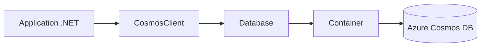

# Azure/azure-cosmos-dotnet-v3

> SDK .NET officiel pour se connecter à Azure Cosmos DB for NoSQL.

## Le problème
Interroger Cosmos DB depuis une application .NET sans écrire soi-même les appels REST.

## Ce que ça fait vraiment
Fournit `CosmosClient` pour créer bases et conteneurs, écrire des éléments et lancer des requêtes SQL paginées avec `FeedIterator`. Le README ne documente rien d'autre : les nombreux liens renvoient vers la documentation Microsoft.

## Comment c'est branché
Schéma simplifié d'après la fiche, sans diagramme fourni.


## Essayer
```bash
Install-Package Microsoft.Azure.Cosmos
```

## Coût et pièges
Il faut un compte Azure et une instance Cosmos DB facturée, ou l'émulateur. Le README montre une clé en clair dans l'exemple. 538 issues ouvertes. Un environnement .NET est nécessaire.

## Ce que ce n'est pas
Ce n'est pas une base de données, seulement le client. Il ne vise que l'API NoSQL de Cosmos DB.

## Alternatives
Non documenté dans le README.

## Pour toi
À ignorer sauf si ta chaîne tourne sur Cosmos DB avec du .NET : sinon le dépôt est lié à un service Azure payant et à un langage hors de ton périmètre habituel.

